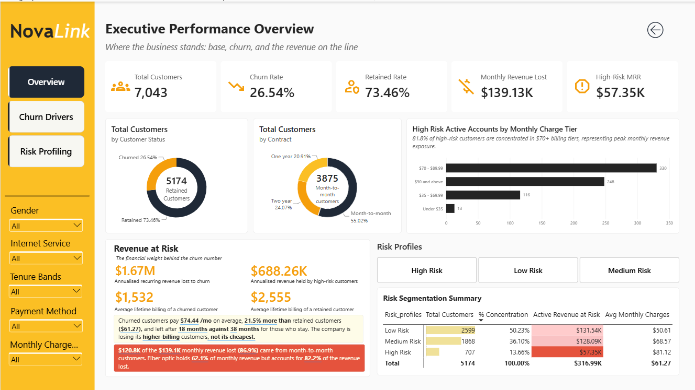
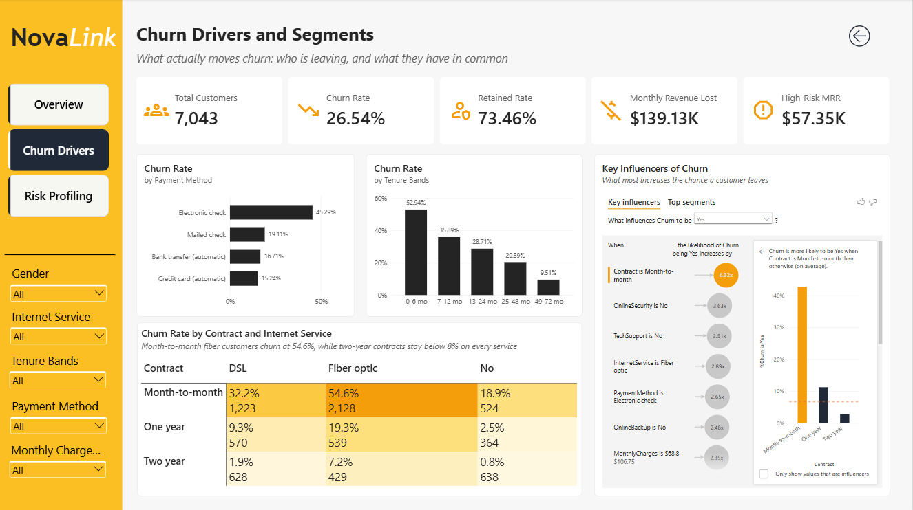
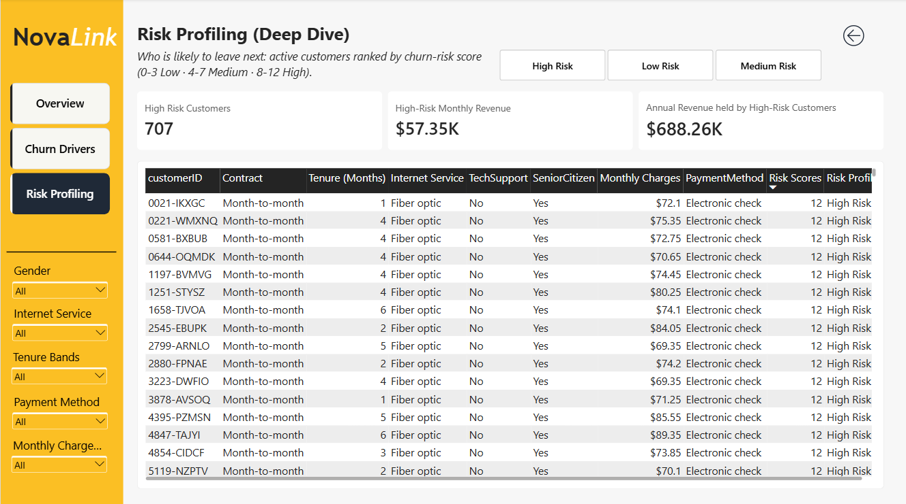

# Telco Customer Churn Analysis

# Project Background

NovaLink Telecom is a fictional residential internet and phone provider. The data comes from the public Telco Customer Churn dataset. I looked at it as an analyst on the retention team, trying to answer two questions: who is leaving, and which customers who are still active could leave next?

I used SQL to clean and analyse the data and built a three-page Power BI dashboard on top of it.

Insights and recommendations are provided on the following key areas:

- **Contract and tenure:** how contract type and time with the company relate to churn
- **Services and pricing:** internet service, add-on services and monthly charges
- **Billing and customer profile:** payment method, paperless billing and customer groups
- **Risk segmentation:** a simple scoring system that ranks active customers by churn risk

The SQL queries used to inspect and clean the data can be found here: [data_cleaning.sql](./sql/data_cleaning.sql)

The SQL queries used for the analysis and the risk view can be found here: [telco_customer_churn_analysis.sql](./sql/telco_customer_churn_analysis.sql)

The Power BI file can be found here: [Telco Customer Churn Analysis.pbix](./PowerBI/Telco%20Customer%20Churn%20Analysis.pbix)

# Data Structure & Initial Checks

The dataset is one table with 7,043 customer records and 21 columns covering contract, services, billing and churn status. The risk view, `v_churn_risk`, was built from it and holds the 5,174 customers who are still active. In Power BI the two are joined on customer ID.

Checks done before the analysis:
- No duplicate records were found and none were removed.
- Tenure runs from 0 to 72 months and monthly charges from $18.25 to $118.75.
- 11 records have a blank `TotalCharges`. All of them have tenure 0 and are still active, so they look like brand new customers who haven't been billed yet. I left them as NULL.

# Executive Summary

### Overview of Findings

NovaLink lost 1,869 of its 7,043 customers (26.54%), and those customers were paying $139,130.85 a month, about 30.50% of total monthly charges. Churn is concentrated among month-to-month customers in their first year, especially those on Fiber optic who pay by electronic check. 707 active customers already match this profile and hold $57,354.80 of monthly revenue.

# Insights Deep Dive

### Contract and tenure

* **Contract type is the strongest split in the data.** Month-to-month customers churn at 42.71% (1,655 of 3,875), compared with 11.27% on one-year and 2.83% on two-year contracts. Month-to-month customers make up 88.55% of everyone who left (1,655 of the 1,869 churners).

* **The first year is where most customers are lost.** Churn is 52.94% for customers in their first 6 months and falls to 9.51% for those with 49 to 72 months. 55.48% of all churners left within 12 months (the 784 and 253 who churned in the first two bands, 1,037 of 1,869), and churned customers stayed 17.98 months on average against 37.57 for retained ones.

* **Contract still matters once tenure is the same.** In the first 6 months, month-to-month churn is 55.20% (1,413 customers) and even after 49 months it is still 26.02% (342 customers). Two-year customers show 0.00% churn in their first 24 months, but those groups are small (29, 39 and 90 customers), so I wouldn't read much into it.

| Tenure | Customers | Churned | Churn Rate |
|---|---|---|---|
| 0 to 6 months | 1,481 | 784 | 52.94% |
| 7 to 12 months | 705 | 253 | 35.89% |
| 13 to 24 months | 1,024 | 294 | 28.71% |
| 25 to 48 months | 1,594 | 325 | 20.39% |
| 49 to 72 months | 2,239 | 213 | 9.51% |

Churn by contract and tenure band (SQL output, the source of the figures in the third bullet):

| Contract | Tenure | Customers | Churned | Churn Rate |
|---|---|---|---|---|
| Month-to-month | 0 to 6 months | 1,413 | 780 | 55.20% |
| Month-to-month | 7 to 12 months | 581 | 244 | 42.00% |
| Month-to-month | 13 to 24 months | 737 | 278 | 37.72% |
| Month-to-month | 25 to 48 months | 802 | 264 | 32.92% |
| Month-to-month | 49 to 72 months | 342 | 89 | 26.02% |
| One year | 0 to 6 months | 39 | 4 | 10.26% |
| One year | 7 to 12 months | 85 | 9 | 10.59% |
| One year | 13 to 24 months | 197 | 16 | 8.12% |
| One year | 25 to 48 months | 518 | 55 | 10.62% |
| One year | 49 to 72 months | 634 | 82 | 12.93% |
| Two year | 0 to 6 months | 29 | 0 | 0.00% |
| Two year | 7 to 12 months | 39 | 0 | 0.00% |
| Two year | 13 to 24 months | 90 | 0 | 0.00% |
| Two year | 25 to 48 months | 274 | 6 | 2.19% |
| Two year | 49 to 72 months | 1,263 | 42 | 3.33% |

### Services and pricing

* **Fiber optic customers churn at more than twice the rate of DSL.** Fiber is at 41.89% (1,297 of 3,096) and DSL at 18.96% (459 of 2,421). Customers with no internet churn at only 7.40%.

* **Fiber also costs the most revenue.** Fiber customers are 69.40% of churners but 82.15% of the monthly revenue lost, because they pay more per month (see the first table below).

* **Missing add-ons go with higher churn.** Customers without tech support churn at 41.64% against 15.17% for those with it. Online security shows almost the same gap (41.77% against 14.61%).

* **The worst combination is month-to-month on Fiber.** That group has 2,128 customers and a 54.61% churn rate. On a two-year contract, Fiber churn drops to 7.23%. Fiber churns more than DSL in every contract type.

* **Higher bills go with higher churn, up to a point.** Churn is 10.86% under $35, 23.65% for $35 to $69.99, 37.95% for $70 to $89.99 and 32.86% at $90 and above. Churned customers paid $74.44 a month on average against $61.27 for retained customers. Fiber is also the pricier service, so I can't tell from this data whether price or the service itself is driving it.

Share of churners and of monthly revenue lost, by internet service (each group's churned customers, or the monthly charges of those customers, divided by the total for all churners):

| Internet Service | Churned | % of all churners | Monthly revenue lost | % of revenue lost |
|---|---|---|---|---|
| DSL | 459 | 24.56% | $22,529.20 | 16.19% |
| Fiber optic | 1,297 | 69.40% | $114,300.05 | 82.15% |
| No internet | 113 | 6.05% | $2,301.60 | 1.65% |

Churn rate by contract and internet service:

| Contract | DSL | Fiber optic | No internet |
|---|---|---|---|
| Month-to-month | 32.22% | 54.61% | 18.89% |
| One year | 9.30% | 19.29% | 2.47% |
| Two year | 1.91% | 7.23% | 0.78% |

### Billing and customer profile

* **Electronic check stands out.** Customers paying this way churn at 45.29% (1,071 of 2,365), against 15.24% to 19.11% for every other method. They are 33.58% of customers (2,365 of 7,043) but 57.30% of churners (1,071 of 1,869).

* **Part of that is contract type, but not all of it.** 1,850 of the 2,365 electronic check customers are month-to-month. Within month-to-month alone, electronic check churn is 53.73% against 32.64% for the other payment methods.

* **Paperless billing customers churn at about double the rate.** 33.57% against 16.33%. This probably overlaps with contract and service type, and I didn't test that separately.

* **Seniors, and customers without a partner or dependents, churn more.** Senior citizens churn at 41.68% against 23.61% and are 16.21% of customers (1,142 of 7,043) but 25.47% of churners (476 of 1,869). Customers with no partner (32.96%) or no dependents (31.28%) churn at about twice the rate of those who have them (19.66% and 15.45%). Gender makes almost no difference (26.92% female, 26.16% male), so I left it out of the risk score.

| Payment Method | Customers | Churned | Churn Rate |
|---|---|---|---|
| Electronic check | 2,365 | 1,071 | 45.29% |
| Mailed check | 1,612 | 308 | 19.11% |
| Bank transfer (automatic) | 1,544 | 258 | 16.71% |
| Credit card (automatic) | 1,522 | 232 | 15.24% |

### Risk segmentation

* **How the score works.** Each customer gets points out of 12: month-to-month contract (2), tenure 0 to 6 months (2), 7 to 12 months (1), 13 to 24 months (1), Fiber optic (2), electronic check (2), no tech support (2) and senior citizen (2). A total of 0 to 3 is Low, 4 to 7 is Medium and 8 to 12 is High. The points are my own rules based on the patterns above, not a fitted model.

* **707 active customers are High Risk.** The split of active customers is 2,599 Low, 1,868 Medium and 707 High. The High group holds $57,354.80 of monthly revenue, which is 18.09% of all active monthly revenue, or about $688K a year.

* **The High Risk group is very uniform.** Almost all of the 707 are on month-to-month contracts and have no tech support, and most are on Fiber and pay by electronic check (see the table below).

Share of the 707 High Risk customers with each trait (from `v_churn_risk`, High Risk rows only):

| Trait | % of High Risk customers |
|---|---|
| Month-to-month contract | 96.61% |
| No tech support | 95.19% |
| Fiber optic internet | 85.15% |
| Electronic check payment | 81.61% |
| Senior citizen | 44.70% |

# Recommendations

Based on the findings above, I would recommend the retention team consider the following:

* Month-to-month customers in their first year churn at over 50%. **Offer new customers a small incentive to move to a one-year contract early on, while churn is highest.**

* Month-to-month Fiber customers churn at 54.61% and account for most of the lost revenue. **Look into service quality and pricing for this group first.**

* Customers without tech support or online security churn at about 42%, against about 15% for those with them. **Try bundling tech support or online security into new Fiber plans and see if churn drops.**

* Electronic check customers churn at 45.29%, and most of them are month-to-month. **Try a small bill credit for switching to automatic payment.**

* 707 active customers are High Risk and hold $57,354.80 a month. **Start retention outreach with this group and compare their churn against a similar group that isn't contacted.**

# Assumptions and Caveats

Some choices I made while working with the data, and things to keep in mind when reading the results:

* The 11 blank `TotalCharges` values all belong to customers with tenure 0 who are still active. I assumed they simply hadn't been billed yet, so I left them as NULL and didn't fill them in or drop them.

* The findings show which groups churn more, not why customers leave. Contract, service, payment and billing all overlap, so I can't point to one factor as the cause.

* The risk score is a set of rules I chose by looking at the results, so it hasn't been tested against anything. It would need to be checked on new customers before anyone relied on it.

* The yearly figures (about $1.67M lost and about $688K at risk) are just the monthly amount times 12. They assume charges stay the same and no customer joins or leaves.

* Some groups are small, for example two-year customers in their first 24 months (fewer than 100 each). Their rates can look extreme for that reason.

* The dataset has no dates, so it is one snapshot in time. I couldn't look at how churn changes month to month.

* NovaLink Telecom is a made-up name to give the project a business setting. The recommendations are ideas worth testing, not strategies I have proven.
